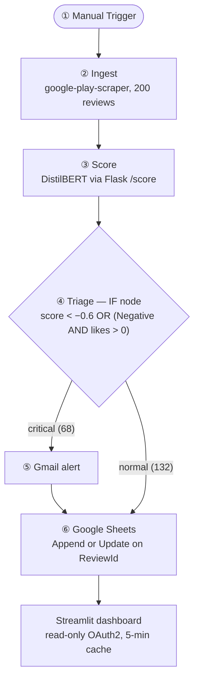
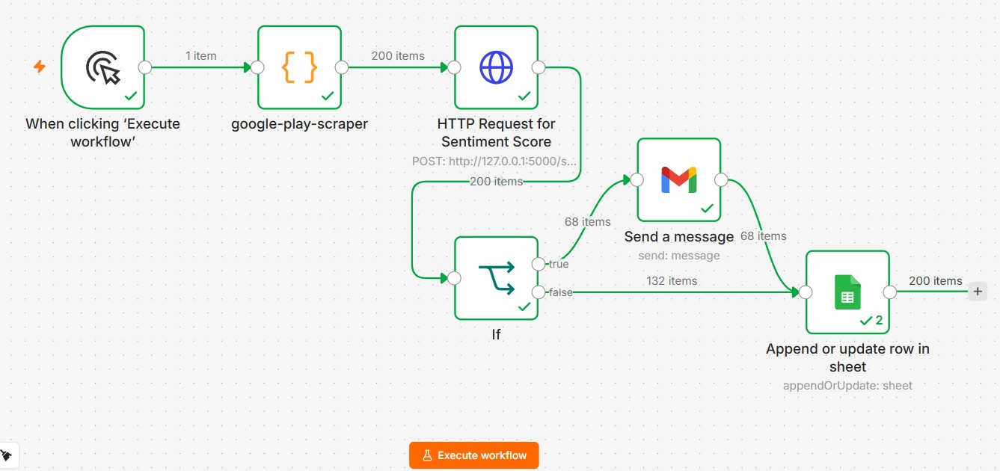
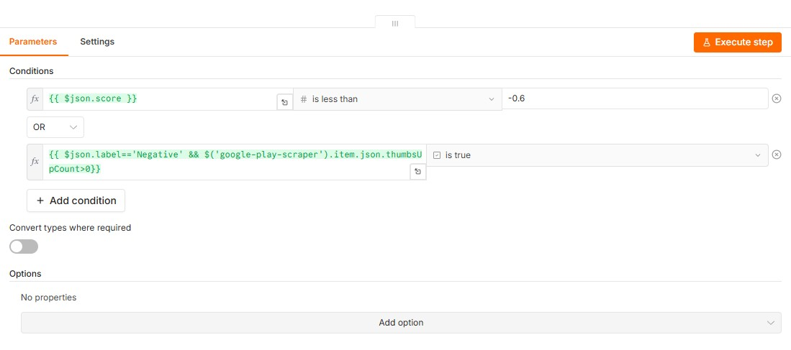
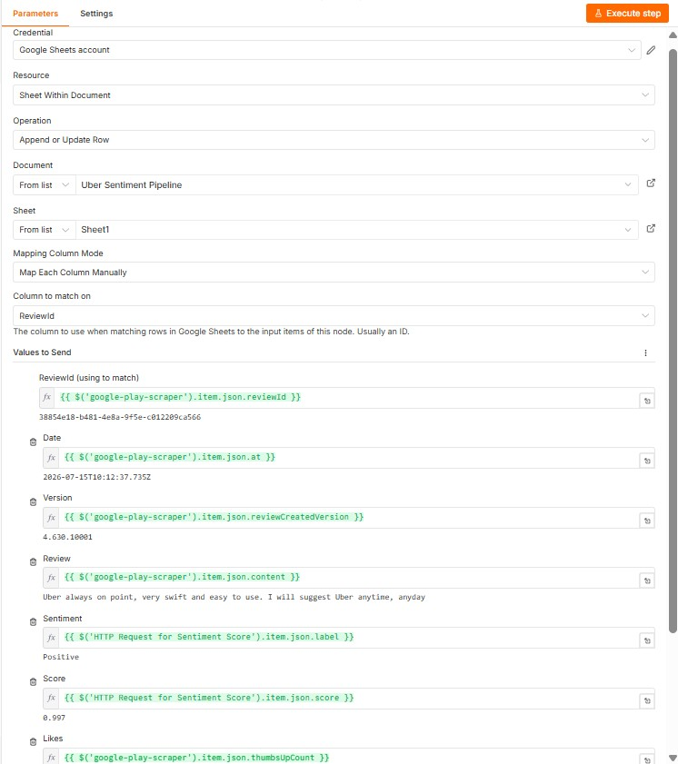
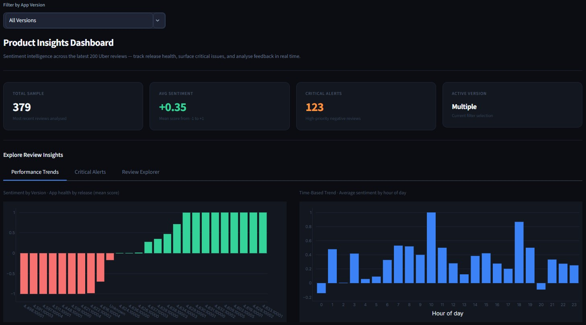
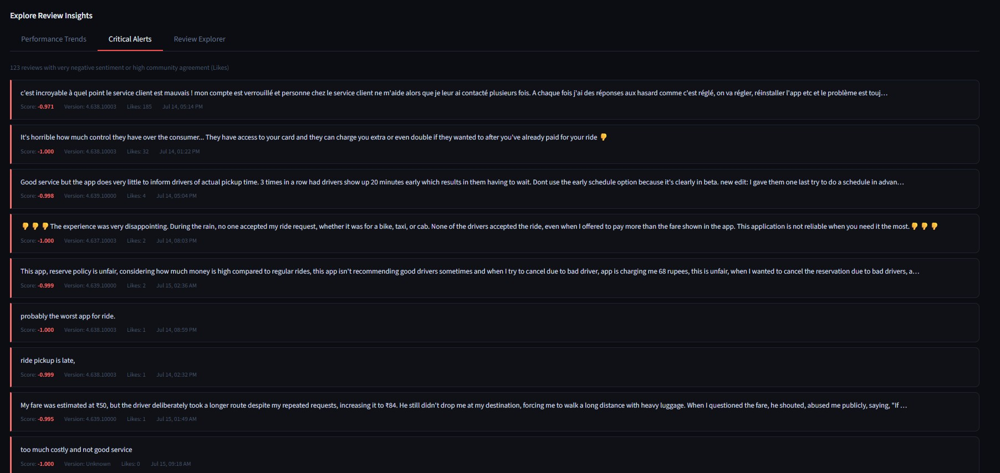

# SaaS Sentiment Intelligence Pipeline
### DistilBERT Scoring · Deterministic Triage Gate · Live Executive Dashboard

**Live Demo →** [saas-sentiment-analyzer.streamlit.app](https://saas-sentiment-analyzer.streamlit.app/)  
**Source Code →** [github.com/LeoTheGreatChan/saas-sentiment-analyzer](https://github.com/LeoTheGreatChan/saas-sentiment-analyzer)  

*Part of a three-project portfolio built on the same discipline: start from a real operational problem, decide deliberately where AI is trusted and where control stays in deterministic code, then test, verify, and measure whether it actually worked. [ops-analytics-pipeline](https://github.com/LeoTheGreatChan/ops-analytics-pipeline) applies it to a 43,739-row delivery dataset behind a validated delay-risk model; [complaint-triage-orchestrator](https://github.com/LeoTheGreatChan/complaint-triage-orchestrator) applies it to a four-agent compliance workflow behind a deterministic escalation gate. Full portfolio: [github.com/LeoTheGreatChan](https://github.com/LeoTheGreatChan).*  

---

## The Problem

Product teams at consumer apps receive thousands of app store reviews every week. The signal is there — pricing complaints, driver behaviour issues, app crashes — but it's buried in noise. Manual triage is slow, inconsistent, and misses critical issues until they've already compounded.

This project automates that triage entirely.

---

## What It Does

A fully automated pipeline that fetches live Uber app reviews from Google Play, scores each one using a pretrained DistilBERT sentiment model, routes critical reviews to a Gmail alert channel, and surfaces everything in a live executive dashboard — with zero manual intervention required between runs.

**One click in n8n. Everything else is automatic.**

From the latest run:
- **379 reviews** processed across multiple app versions
- **+0.35 average sentiment score** — net positive but with significant negative clusters
- **123 critical alerts** automatically identified and routed
- **68 Gmail alerts** fired on that run, one per review the triage rule flagged

---

## Manual Triage vs. This Pipeline

Manual review triage means a person skimming reviews roughly in arrival order, prioritising by gut feel, and depending on a reviewer noticing a given complaint themselves — a process with no built-in way to catch content outside a reviewer's working language. The dashboard's current top alert is a concrete example of what that misses: a French-language review reporting a locked account and unresponsive support, scored −0.971 with 185 community likes. This pipeline runs every review through the same scorer and the same escalation rule: that review is flagged on its score, and its 185 likes put it first on the dashboard's alert list.

The comparison here is qualitative, grounded in the pipeline's own documented behaviour rather than a measured time-saved figure: one scoring and escalation rule applied to every review, an escalation decision that doesn't depend on a human noticing, and every action logged to an auditable, deduplicated sheet rather than living only in someone's inbox or memory.

---

## Data

**Source:** live Uber app reviews from the Google Play Store, fetched on each run with [`google-play-scraper`](https://www.npmjs.com/package/google-play-scraper) (no API key required), 200 most recent reviews per run from the US store with English requested (`country: 'us'`, `lang: 'en'`).

**Built on a live, accumulating feed** — each run appends new reviews to the same Google Sheet, which currently holds 379 deduplicated reviews across multiple app versions.

**Stored fields:** ReviewId, Date, Version, Review, Sentiment, Score, Likes.

---

## Data Quality & Validation

**Deduplication by ReviewId:** consecutive runs fetch overlapping review windows. Every write uses `Append or Update Row` keyed on `ReviewId`, so a re-run updates existing rows rather than duplicating them, and version-level averages stay accurate across repeated runs.

**What the score means:** the scorer returns the model's confidence in its label, signed by polarity, from −1.0 (confidently negative) to +1.0 (confidently positive). A score of −0.971 means the model is 97.1% confident the review is negative; it measures certainty, not the intensity of the complaint. The triage threshold of −0.6 is therefore a confidence cut-off on negative labels.

**Language coverage:** the scoring checkpoint, `distilbert-base-uncased-finetuned-sst-2-english`, is trained on English sentences. Ingestion requests English-language reviews, and non-English reviews still come through — the current top alert is in French. Non-English reviews pass through the same scorer and the same escalation rule, and their scores are a usable but uncalibrated signal. A multilingual sentiment model is the first entry under Extension Opportunities; the Flask wrapper and every downstream node stay the same.

**Escalation rule, checked against the full sheet:** the IF node flags a review when its score is below −0.6, or when it's labelled Negative with at least one like. Across all 379 stored reviews, the score branch flags 123 and the likes branch flags 8, all 8 of which are already among the 123. The model reports high confidence on almost every review (123 of the 124 Negative-labelled reviews score below −0.6), so the threshold currently works out to "every negative review", and the likes branch adds no reviews of its own. Prioritisation happens on the dashboard instead, which ranks flagged reviews by community likes and then by score. Separating severity from polarity at the triage step is the second entry under Extension Opportunities.

---

## Pipeline Architecture

The pipeline runs as an n8n workflow with six stages, processing 200 reviews per run with all item counts visible between nodes: 1 → 200 → 200 → 68 (critical) + 132 (normal) → 200 written to Sheets.

**① Trigger — Manual (upgradeable to Schedule)**  
A manual trigger node fires the workflow on demand. Upgrading to a scheduled run — e.g. every Sunday at 9am — requires replacing this single node with a Schedule Trigger. Every downstream node stays identical.

**② Ingest — google-play-scraper**  
A JavaScript Code node fetches the latest Uber reviews from Google Play using `google-play-scraper` (no API key required). Returns 200 structured items per run with consistent fields: review text, app version, timestamp, and community likes count.

**③ Score — DistilBERT via Flask**  
An HTTP Request node POSTs each review to a local Flask endpoint (`POST: http://127.0.0.1:5000/score`) wrapping a DistilBERT model fine-tuned on SST-2. Each review returns a sentiment label (Positive/Negative) and a confidence score from −1.0 to +1.0. The scorer runs as a persistent service — the model loads once and stays warm across all 200 calls.

**④ Triage — IF node with compound alert logic**  

An IF node applies the alert threshold using two conditions linked by OR:
- `{{ $json.score }} is less than -0.6` — confidently negative score
- `{{ $json.label=='Negative' && $('google-play-scraper').item.json.thumbsUpCount>0 }}` — negative reviews with at least one community like

From the latest run: **68 items to the true branch** (critical), **132 items to the false branch** (normal).

**What makes it different:** DistilBERT interprets each review's sentiment; the IF node's compound OR logic decides who gets escalated. The model interprets, deterministic code decides — the same split used across this portfolio.

**⑤ Alert — Gmail**  
A Gmail node sends an automated email for each of the 68 critical reviews, including full review text, version number, sentiment score, and timestamp. No manual monitoring required — critical feedback surfaces in the inbox automatically.

**⑥ Write — Google Sheets (deduplicated)**  

A Google Sheets node writes all 200 scored reviews using `Append or Update Row` with `ReviewId` as the deduplication key. Re-running the pipeline on consecutive days never produces duplicate rows — the operation is fully idempotent. Field mappings pull from two upstream nodes: review metadata from `google-play-scraper`, sentiment label and score from `HTTP Request for Sentiment Score`.

---

## Live Dashboard

A Streamlit dashboard reads live from Google Sheets through a read-only OAuth2 credential scoped to that one spreadsheet, with a 5-minute cache TTL. No redeployment needed when new data arrives — run the n8n workflow and the dashboard updates automatically on the next page load.

**Four headline metric cards** update dynamically when the version filter changes:
- **379** total reviews in current selection
- **+0.35** average sentiment score — colour-coded green for positive
- **123** critical alerts — colour-coded orange
- **Multiple** active versions (changes to a specific version when filtered)

**Performance Trends tab** shows two charts side by side: sentiment by app version (colour-coded bar chart — red for negative, green for positive) and average sentiment by hour of day (bar chart). The version bar chart clearly shows older releases (4.497–4.518) clustering negative while recent releases (4.630+) trend strongly positive.

**Critical Alerts tab** lists every flagged review, ranked by community likes and then by score:

123 flagged reviews, each shown with score (colour-coded red), version, likes count, and full review text. The top alert — a French-language review about a locked account and unresponsive support — scored −0.971 with 185 community likes, more than five times the next-most-liked alert.

**Review Explorer tab** shows the full scored dataset with date, version, review text, sentiment label, score, and likes — filterable by version and exportable as CSV.

---

## What's ML and What's Deterministic

One component in this pipeline is a model; everything that decides or records an outcome is plain, inspectable logic:

| Component | Technique | Type |
|---|---|---|
| Sentiment label and score | DistilBERT (SST-2 checkpoint) served by Flask | Pretrained ML, inference only |
| Escalation decision | Compound OR condition in an n8n IF node | Deterministic rule |
| Deduplication | Append or Update keyed on ReviewId | Deterministic |
| Alerts and storage | n8n Gmail and Google Sheets nodes | Integration |
| Dashboard aggregates | pandas group-bys by version and hour of day | Descriptive statistics |

---

## Tech Stack

| Layer | Technology |
|---|---|
| Orchestration | n8n (self-hosted, local) |
| Review ingestion | google-play-scraper (JS, no API key) |
| Sentiment scoring | DistilBERT (distilbert-base-uncased-finetuned-sst-2-english) |
| Scorer API | Python · Flask |
| Alert delivery | Gmail (via n8n OAuth node) |
| Data store | Google Sheets (append + dedup via ReviewId) |
| Dashboard | Python · Streamlit |
| Auth | Google OAuth2, read-only Sheets scope, via Streamlit Secrets |
| Hosting | Streamlit Community Cloud, kept warm by an hourly headless-browser visit (GitHub Actions + Playwright) |

---

## Key Design Decisions

**Why n8n over a Python script?** n8n makes the pipeline visual, auditable, and modifiable without code changes. The manual→schedule trigger swap is a single node replacement. Non-technical stakeholders can read the canvas and understand what the pipeline does without touching Python.

**Why Google Sheets over a database?** Sheets provides a free, inspectable, shareable data store with zero infrastructure overhead. The architecture is identical whether the destination is Sheets, BigQuery, or Postgres — only the write node changes.

**Why a persistent Flask scorer instead of scoring inside n8n?** n8n's Code node would reload the DistilBERT model on every execution. A persistent Flask service loads the model once and keeps it warm — scoring 200 reviews takes seconds rather than minutes.

**Why deduplication by ReviewId?** Running the pipeline on consecutive days fetches overlapping review windows. Without deduplication, the same review appears multiple times and skews version-level sentiment averages. ReviewId as the match key makes the pipeline idempotent — safe to re-run at any time.

**Why OAuth2 via Streamlit Secrets instead of a service account?** A refresh token stored in Streamlit Secrets works identically in local and production environments, keeps every credential out of the codebase, and is scoped read-only to the single spreadsheet the dashboard reads (`spreadsheets.readonly`, no Drive access). Service-account key creation is disabled by the Google Cloud organisation policy in this environment, which settled the choice.

**Why decide escalation in an IF node instead of asking the model to flag critical reviews itself?** Blurring "how positive is this review" and "does this review need action" into a single model call would make the escalation rule opaque and hard to audit. Keeping it as a compound OR condition in an IF node means the rule is plain code anyone can read, test, and change without touching the model — the same boundary held across this portfolio's other builds. It's also directly checkable, which is how the rule's current behaviour surfaced: counted against the full sheet, the likes branch adds no reviews beyond the score branch (see Data Quality & Validation). Because the rule is two plain conditions in one node, tightening it is a one-field change, with no prompt rewrite or retraining involved. The ReviewId dedup key is verified the same way: re-runs update existing rows rather than duplicating them.

---

## Running It

1. `pip install -r requirements.txt`
2. Start the scorer: `python scorer.py` — loads DistilBERT once and serves `POST /score` (body `{"text": "..."}`) and `GET /health` on port 5000.
3. Import `n8n_workflow.json` into n8n, attach your own Gmail and Google Sheets credentials, and set the Gmail recipient and the Sheets document (both ship as placeholders). The HTTP Request node already points at `http://127.0.0.1:5000/score`.
4. Run the dashboard: set `SHEET_ID` in `app.py` to your sheet, add `.streamlit/secrets.toml` with a `[gcp]` section containing `client_id`, `client_secret`, and a `refresh_token` issued for the `spreadsheets.readonly` scope, then `streamlit run app.py`.

---

## Extension Opportunities

- **Multilingual scoring** — swap the English SST-2 checkpoint for a multilingual sentiment model so non-English reviews get calibrated scores; the Flask wrapper stays identical
- **Severity-aware triage** — raise the score cut-off well above −0.6, since the model's confidence clusters near ±1.0, or use community likes to rank alerts rather than gate them, so the critical branch separates severity rather than polarity
- **Schedule trigger** — swap Manual Trigger for Schedule Trigger in n8n (one node, no code changes)
- **Multi-app** — add a second Code node branch for competitor apps (e.g. Lyft) and compare sentiment trends side by side
- **Slack alerts** — replace or supplement Gmail node with Slack webhook for team-wide visibility
- **BigQuery sink** — replace Google Sheets node with BigQuery node for enterprise-scale storage

---

*Built by Leo Chan · July 2026*
